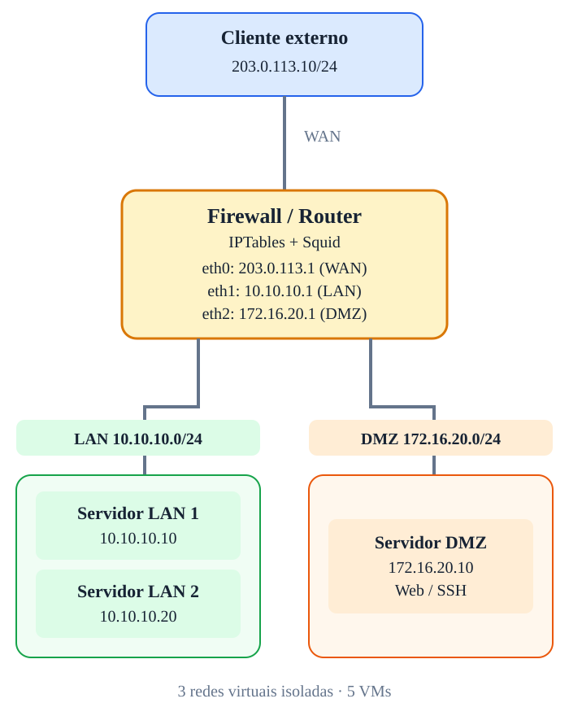

# Laboratório de Redes — IPTables, NAT e Squid

Arquitetura didática com **5 máquinas virtuais** e **3 redes virtuais isoladas**.

## Índice

- [Arquitetura e endereçamento](docs/00-arquitetura.md)
- [Matriz de comunicação](docs/11-matriz-de-comunicacao.md)
- [Preparação e requisitos](docs/12-preparacao.md)
- [Roteamento e conectividade](docs/01-roteamento.md)
- [IPTables e filtragem](docs/02-filtragem.md)
- [Stateful Firewall](docs/03-stateful.md)
- [SNAT](docs/04-snat.md)
- [MASQUERADE](docs/05-masquerade.md)
- [DNAT e Port Forwarding](docs/06-dnat.md)
- [Segmentação LAN e DMZ](docs/07-dmz.md)
- [Comunicação lateral na LAN](docs/08-lateral.md)
- [Squid Proxy](docs/09-squid.md)
- [Desafio integrador](docs/10-desafio.md)

## Máquinas

| VM | Zona | Endereço | Função |
|---|---|---|---|
| EXT01 | WAN | 203.0.113.10/24 | Cliente externo e testes |
| FW01 | WAN/LAN/DMZ | 203.0.113.1 / 10.10.10.1 / 172.16.20.1 | IPTables, NAT, Squid |
| APP01 | LAN | 10.10.10.10/24 | Aplicação HTTP e SSH |
| DB01 | LAN | 10.10.10.20/24 | Banco de dados, DNS e testes |
| WEB01 | DMZ | 172.16.20.10/24 | Web pública e SSH |

> **Nota:** `203.0.113.0/24` é uma rede reservada para documentação. Aqui ela simula a WAN, não representa conectividade real com a Internet. As interfaces `eth0`, `eth1` e `eth2` são nomes didáticos e podem variar na VM.

Os SVGs reproduzem os diagramas estilizados apresentados na conversa, com cartões coloridos, organização espacial e legendas. Os arquivos `.dot` são alternativas para edição em Graphviz e **não** reproduzem o mesmo estilo visual dos SVGs.

---

© 2026 Sec4US. Todos os direitos reservados. Conteúdo do treinamento 'Introdução a Redes IPv4'. É proibido o compartilhamento, a divulgação ou a reprodução deste material sem aprovação prévia por escrito da Sec4US.
