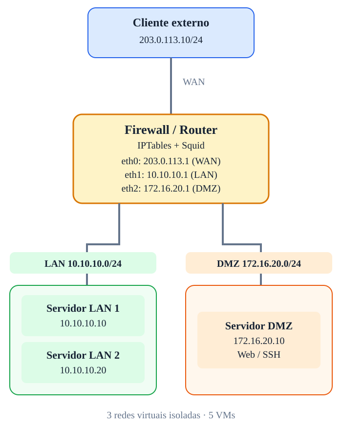

# Arquitetura e endereçamento

## Segmentos

| Rede | Subnet | Interface FW01 | Finalidade |
|---|---|---|---|
| WAN | `203.0.113.0/24` | `eth0` — `203.0.113.1` | Cliente externo simulado |
| LAN | `10.10.10.0/24` | `eth1` — `10.10.10.1` | Servidores internos |
| DMZ | `172.16.20.0/24` | `eth2` — `172.16.20.1` | Serviços publicados |

## Hosts e gateways

| Host | IP | Gateway | Serviços |
|---|---|---|---|
| EXT01 | `203.0.113.10/24` | `203.0.113.1` | curl, nc, nmap, HTTP de teste |
| FW01 | `203.0.113.1/24`, `10.10.10.1/24`, `172.16.20.1/24` | sem gateway externo no cenário isolado | IPTables, conntrack, Squid |
| APP01 | `10.10.10.10/24` | `10.10.10.1` | HTTP, SSH |
| DB01 | `10.10.10.20/24` | `10.10.10.1` | PostgreSQL ou MariaDB, DNS |
| WEB01 | `172.16.20.10/24` | `172.16.20.1` | Nginx, SSH |

## Conceitos-chave

- Tráfego entre APP01 e DB01 na mesma LAN não passa por FW01.
- Tráfego entre WAN, LAN e DMZ passa por FW01.
- NAT não é necessário para roteamento entre subnets; pode ser aplicado como exercício separado.
- A rede externa simulada é isolada; se houver Internet real, será necessária uma arquitetura de saída adicional.
- Utilize snapshots por fase e uma rede de administração independente quando possível.
