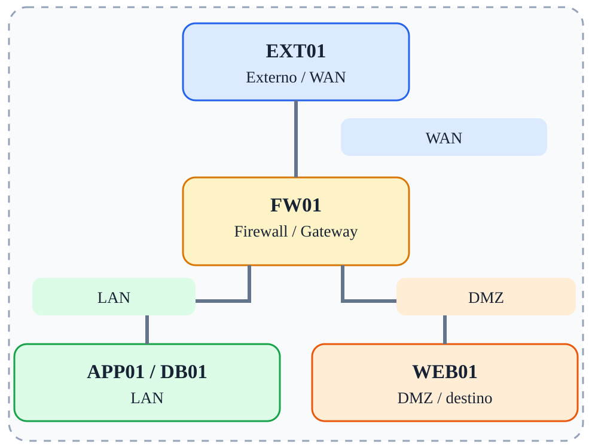

# Fase 01 — Roteamento e conectividade

[← Índice](../README.md)



## Objetivo

Configurar endereços IP, gateways e roteamento entre WAN, LAN e DMZ.

## Ferramentas e verificações

`ping, traceroute, ip route, tcpdump`

## Procedimento / exemplo

```bash
# FW01: habilitar encaminhamento
sysctl -w net.ipv4.ip_forward=1
# EXT01: rotas explícitas para testar roteamento puro
ip route add 10.10.10.0/24 via 203.0.113.1
ip route add 172.16.20.0/24 via 203.0.113.1
```
Configure as regras FORWARD para permitir o tráfego de teste. Observe que não é necessário NAT.

## Evidências esperadas

- Captura de tráfego mostrando IPs e portas relevantes.
- Saída dos comandos de validação.
- Explicação do caminho do pacote e da decisão de filtragem.

## Cuidados

As regras apresentadas são exemplos isolados, não uma política completa pronta para produção. Execute-as em snapshots descartáveis; preserve acesso administrativo e remova regras de fases anteriores antes de começar uma nova.
