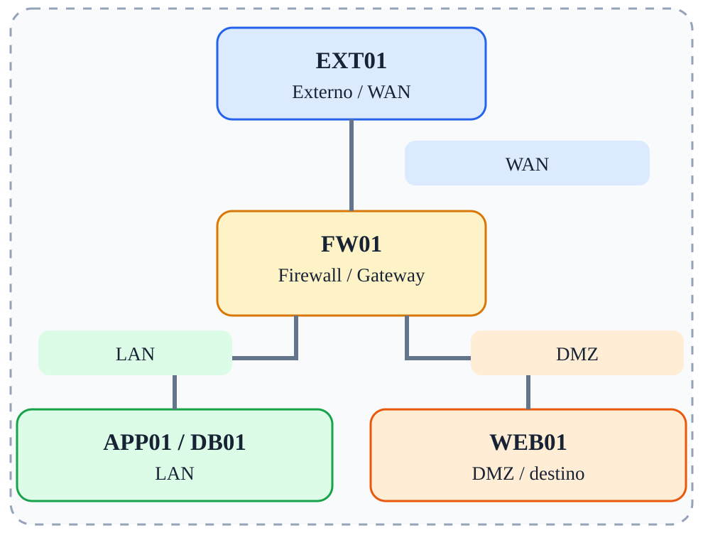

# Fase 02 — IPTables e filtragem

[← Índice](../README.md)



## Objetivo

Compreender INPUT, OUTPUT, FORWARD e políticas ACCEPT/DROP.

## Ferramentas e verificações

`iptables -L -n -v; curl; nc`

## Procedimento / exemplo

```bash
iptables -A FORWARD -i eth0 -o eth2 -p tcp -d 172.16.20.10 --dport 80 -j ACCEPT
iptables -A FORWARD -i eth0 -o eth1 -p tcp -d 10.10.10.20 --dport 22 -j DROP
iptables -L FORWARD -n -v --line-numbers
```
Essas são regras ilustrativas: a ordem e as políticas existentes afetam o resultado.

## Evidências esperadas

- Captura de tráfego mostrando IPs e portas relevantes.
- Saída dos comandos de validação.
- Explicação do caminho do pacote e da decisão de filtragem.

## Cuidados

As regras apresentadas são exemplos isolados, não uma política completa pronta para produção. Execute-as em snapshots descartáveis; preserve acesso administrativo e remova regras de fases anteriores antes de começar uma nova.

---

© 2026 Sec4US. Todos os direitos reservados. Conteúdo do treinamento 'Introdução a Redes IPv4'. É proibido o compartilhamento, a divulgação ou a reprodução deste material sem aprovação prévia por escrito da Sec4US.
