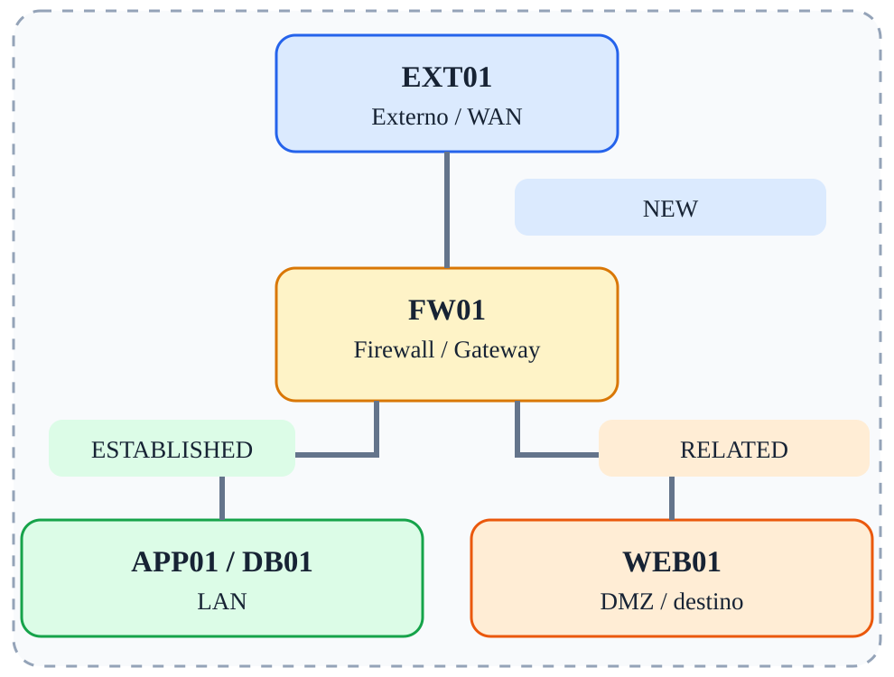

# Fase 03 — Stateful Firewall

[← Índice](../README.md)



## Objetivo

Aplicar regras NEW, ESTABLISHED, RELATED e INVALID.

## Ferramentas e verificações

`conntrack -L; tcpdump; curl`

## Procedimento / exemplo

```bash
iptables -A FORWARD -m conntrack --ctstate ESTABLISHED,RELATED -j ACCEPT
iptables -A FORWARD -m conntrack --ctstate INVALID -j DROP
iptables -A FORWARD -i eth1 -o eth0 -m conntrack --ctstate NEW -j ACCEPT
conntrack -L
```

## Evidências esperadas

- Captura de tráfego mostrando IPs e portas relevantes.
- Saída dos comandos de validação.
- Explicação do caminho do pacote e da decisão de filtragem.

## Cuidados

As regras apresentadas são exemplos isolados, não uma política completa pronta para produção. Execute-as em snapshots descartáveis; preserve acesso administrativo e remova regras de fases anteriores antes de começar uma nova.
