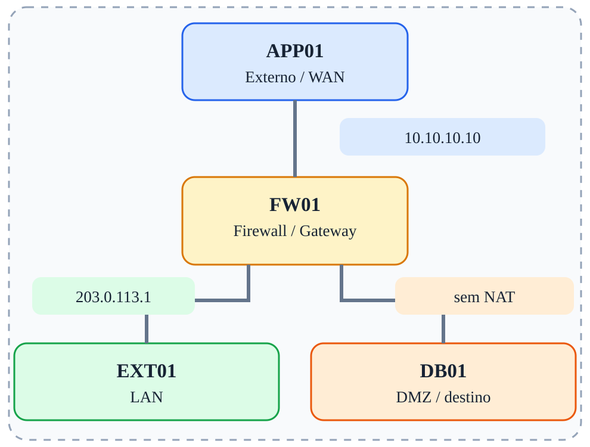

# Fase 04 — SNAT

[← Índice](../README.md)



## Objetivo

Modificar o IP de origem no POSTROUTING.

## Ferramentas e verificações

`tcpdump; iptables -t nat -L -n -v`

## Procedimento / exemplo

```bash
iptables -t nat -A POSTROUTING -s 10.10.10.0/24 -o eth0 -j SNAT --to-source 203.0.113.1
```
No EXT01, retire as rotas explícitas para a LAN para comparar o retorno sem e com NAT. Mantenha regras FORWARD permissivas para o fluxo autorizado.

## Evidências esperadas

- Captura de tráfego mostrando IPs e portas relevantes.
- Saída dos comandos de validação.
- Explicação do caminho do pacote e da decisão de filtragem.

## Cuidados

As regras apresentadas são exemplos isolados, não uma política completa pronta para produção. Execute-as em snapshots descartáveis; preserve acesso administrativo e remova regras de fases anteriores antes de começar uma nova.

---

© 2026 Sec4US. Todos os direitos reservados. Conteúdo do treinamento 'Introdução a Redes IPv4'. É proibido o compartilhamento, a divulgação ou a reprodução deste material sem aprovação prévia por escrito da Sec4US.
