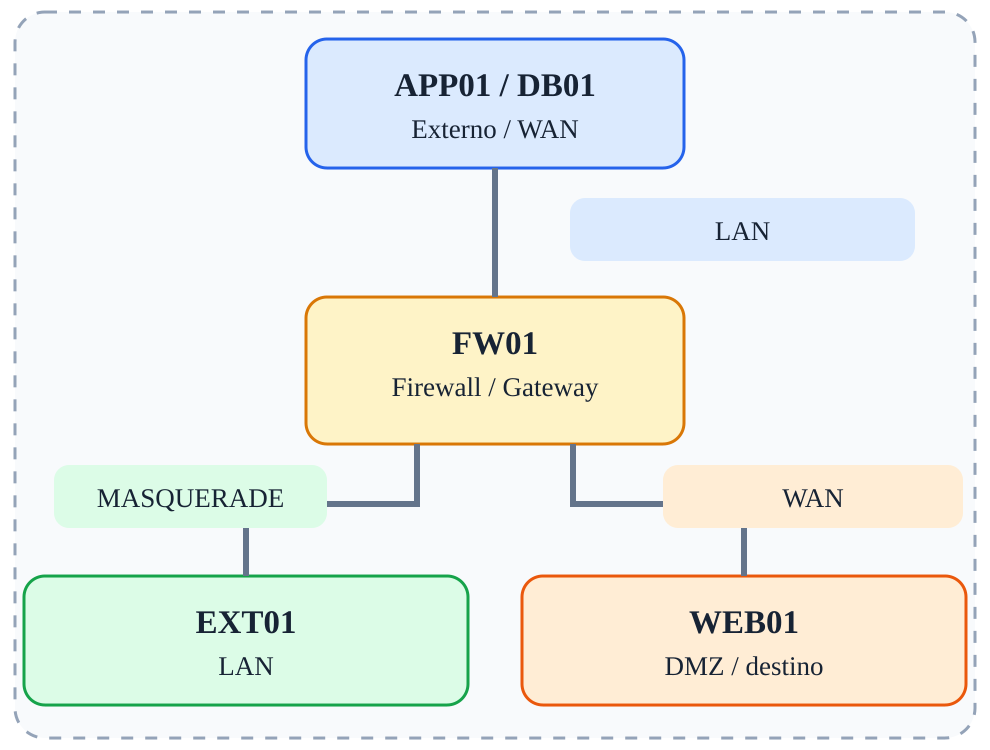

# Fase 05 — MASQUERADE

[← Índice](../README.md)



## Objetivo

Comparar MASQUERADE com SNAT de endereço fixo.

## Ferramentas e verificações

`tcpdump; conntrack -L`

## Procedimento / exemplo

```bash
# Remova a regra SNAT anterior antes de testar esta alternativa
iptables -t nat -A POSTROUTING -s 10.10.10.0/24 -o eth0 -j MASQUERADE
```
Compare com SNAT fixo e observe os fluxos no conntrack.

## Evidências esperadas

- Captura de tráfego mostrando IPs e portas relevantes.
- Saída dos comandos de validação.
- Explicação do caminho do pacote e da decisão de filtragem.

## Cuidados

As regras apresentadas são exemplos isolados, não uma política completa pronta para produção. Execute-as em snapshots descartáveis; preserve acesso administrativo e remova regras de fases anteriores antes de começar uma nova.
