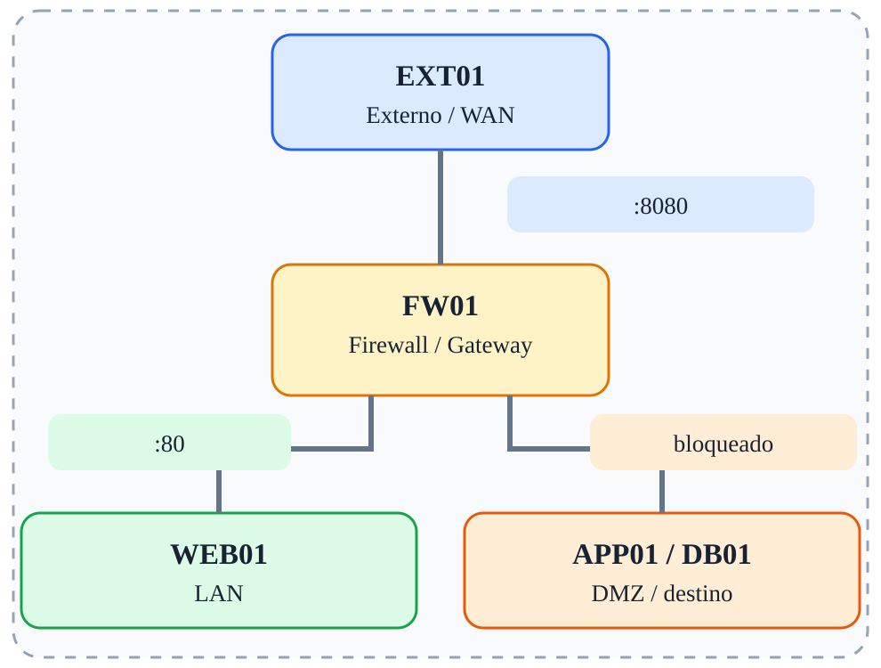

# Fase 06 — DNAT e Port Forwarding

[← Índice](../README.md)



## Objetivo

Publicar WEB01:80 através de FW01:8080.

## Ferramentas e verificações

`curl http://203.0.113.1:8080; tcpdump`

## Procedimento / exemplo

```bash
iptables -t nat -A PREROUTING -i eth0 -p tcp --dport 8080 -j DNAT --to-destination 172.16.20.10:80
iptables -A FORWARD -i eth0 -o eth2 -p tcp -d 172.16.20.10 --dport 80 -m conntrack --ctstate NEW -j ACCEPT
iptables -A FORWARD -m conntrack --ctstate ESTABLISHED,RELATED -j ACCEPT
# EXT01
curl http://203.0.113.1:8080/
```

## Evidências esperadas

- Captura de tráfego mostrando IPs e portas relevantes.
- Saída dos comandos de validação.
- Explicação do caminho do pacote e da decisão de filtragem.

## Cuidados

As regras apresentadas são exemplos isolados, não uma política completa pronta para produção. Execute-as em snapshots descartáveis; preserve acesso administrativo e remova regras de fases anteriores antes de começar uma nova.
