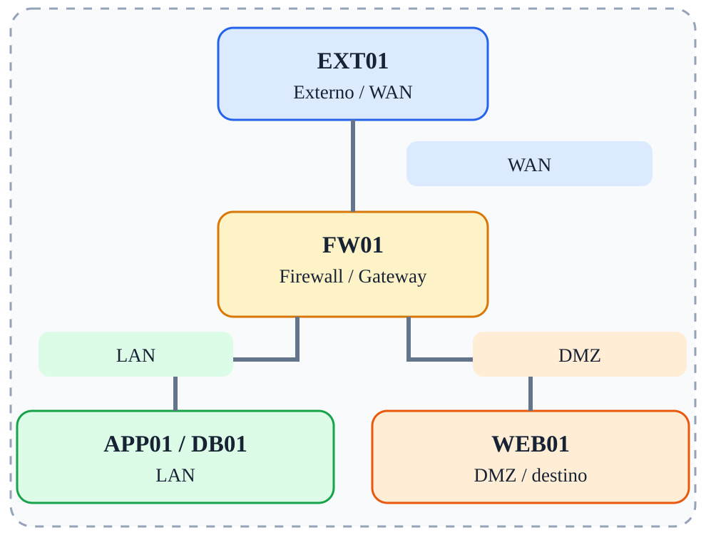

# Fase 07 — Segmentação LAN e DMZ

[← Índice](../README.md)



## Objetivo

Isolar zonas e permitir apenas acessos estritamente necessários.

## Ferramentas e verificações

`iptables -L FORWARD -n -v; nc`

## Procedimento / exemplo

```bash
iptables -A FORWARD -i eth2 -o eth1 -s 172.16.20.10 -d 10.10.10.20 -p tcp --dport 5432 -j ACCEPT
iptables -A FORWARD -i eth2 -o eth1 -j DROP
```
Coloque a permissão específica antes do bloqueio geral. Verifique a política de retorno stateful.

## Evidências esperadas

- Captura de tráfego mostrando IPs e portas relevantes.
- Saída dos comandos de validação.
- Explicação do caminho do pacote e da decisão de filtragem.

## Cuidados

As regras apresentadas são exemplos isolados, não uma política completa pronta para produção. Execute-as em snapshots descartáveis; preserve acesso administrativo e remova regras de fases anteriores antes de começar uma nova.

---

© 2026 Sec4US. Todos os direitos reservados. Conteúdo do treinamento 'Introdução a Redes IPv4'. É proibido o compartilhamento, a divulgação ou a reprodução deste material sem aprovação prévia por escrito da Sec4US.
