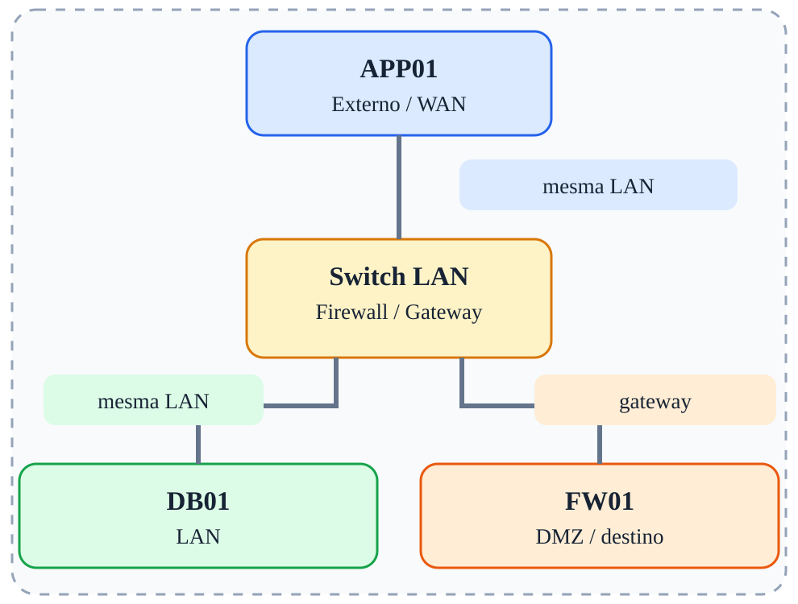

# Fase 08 — Comunicação lateral na LAN

[← Índice](../README.md)



## Objetivo

Mostrar que APP01 e DB01 se comunicam diretamente sem passar por FW01.

## Ferramentas e verificações

`tcpdump no FW01 e APP01; ip neigh`

## Procedimento / exemplo

```bash
# APP01: tráfego direto para DB01
ping 10.10.10.20
# FW01: normalmente não verá o tráfego unicast entre os dois hosts na mesma LAN
tcpdump -ni eth1 host 10.10.10.10 and host 10.10.10.20
```
Reforce que filtros no FW01 não substituem firewalls de host ou segmentação L2.

## Evidências esperadas

- Captura de tráfego mostrando IPs e portas relevantes.
- Saída dos comandos de validação.
- Explicação do caminho do pacote e da decisão de filtragem.

## Cuidados

As regras apresentadas são exemplos isolados, não uma política completa pronta para produção. Execute-as em snapshots descartáveis; preserve acesso administrativo e remova regras de fases anteriores antes de começar uma nova.

---

© 2026 Sec4US. Todos os direitos reservados. Conteúdo do treinamento 'Introdução a Redes IPv4'. É proibido o compartilhamento, a divulgação ou a reprodução deste material sem aprovação prévia por escrito da Sec4US.
