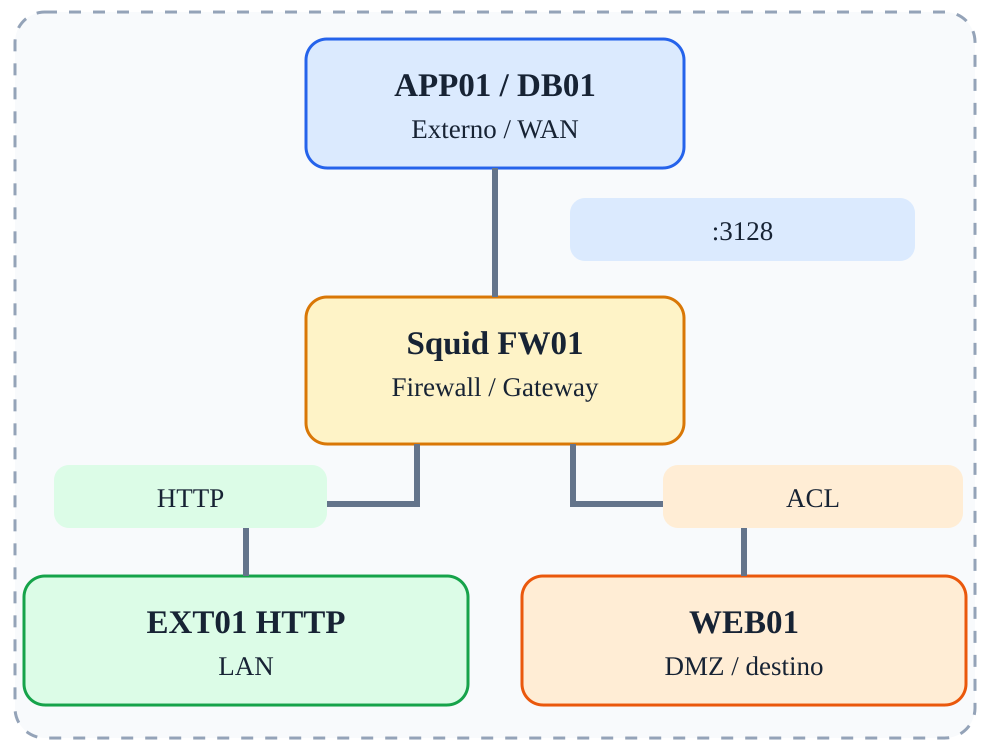

# Fase 09 — Squid Proxy

[← Índice](../README.md)



## Objetivo

Configurar proxy explícito e ACLs HTTP.

## Ferramentas e verificações

`curl -x http://10.10.10.1:3128; tail -f /var/log/squid/access.log`

## Procedimento / exemplo

```bash
# Exemplo de ACL em squid.conf (ajuste à configuração da distribuição)
acl lan src 10.10.10.0/24
http_access allow lan
http_access deny all
http_port 3128 
# APP01
curl -x http://10.10.10.1:3128 http://203.0.113.10/
```
Posicione regras de autorização cuidadosamente: Squid processa http_access em ordem. Não abra o proxy para a WAN.

## Proxy Transparente

```bash
# Exemplo de ACL em squid.conf (ajuste à configuração da distribuição)
acl lan src 10.10.10.0/24
http_access allow lan
http_access deny all

# Porta de proxy explícito (forward-proxy) — OBRIGATÓRIA.
# O Squid exige ao menos uma porta forward-proxy. Uma porta somente
# 'intercept' faz o serviço abortar com "No forward-proxy ports configured"
# e, em seguida, "FATAL: mimeLoadIcon: cannot parse internal URL ...:0/...".
http_port 3128

# Porta dedicada à interceptação (precisa ser diferente da porta forward-proxy).
http_port 3129 intercept

#IPTABLES (mesmo host do FW) — redirecione para a porta 'intercept' (3129)
iptables -t nat -A PREROUTING -s 10.10.10.0/24 -p tcp --dport 80 -j REDIRECT --to-port 3129

#IPTABLES (outra maquina)
iptables -t nat -A PREROUTING -s 10.10.10.0/24 -p tcp --dport 80 -j DNAT --to-destination 172.16.20.10:80

# APP01 — no modo transparente o cliente NÃO usa -x (sem proxy configurado)
curl http://203.0.113.10/
```

## Evidências esperadas

- Captura de tráfego mostrando IPs e portas relevantes.
- Saída dos comandos de validação.
- Explicação do caminho do pacote e da decisão de filtragem.

## Cuidados

As regras apresentadas são exemplos isolados, não uma política completa pronta para produção. Execute-as em snapshots descartáveis; preserve acesso administrativo e remova regras de fases anteriores antes de começar uma nova.

---

© 2026 Sec4US. Todos os direitos reservados. Conteúdo do treinamento '[Introdução a Redes IPv4](https://sec4us.com.br/courses/introducao-a-redes-ipv4?utm_source=github&utm_medium=social&utm_campaign=netresource)'. É proibido o compartilhamento, a divulgação ou a reprodução deste material sem aprovação prévia por escrito da Sec4US.
