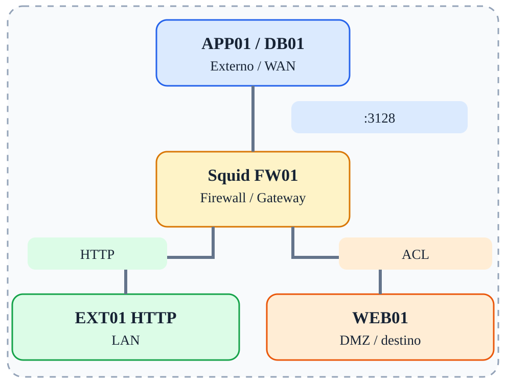

# Fase 09 — Squid Proxy

[← Índice](../README.md)



## Objetivo

Configurar proxy explícito e ACLs HTTP.

## Ferramentas e verificações

`curl -x http://10.10.10.1:3128; tail -f /var/log/squid/access.log`

## Procedimento / exemplo

```bash
# Exemplo de ACL em squid.conf (ajuste à configuração da distribuição)
acl lan src 10.10.10.0/24
http_access allow lan
http_access deny all
http_port 3128
# APP01
curl -x http://10.10.10.1:3128 http://203.0.113.10/
```
Posicione regras de autorização cuidadosamente: Squid processa http_access em ordem. Não abra o proxy para a WAN.

## Evidências esperadas

- Captura de tráfego mostrando IPs e portas relevantes.
- Saída dos comandos de validação.
- Explicação do caminho do pacote e da decisão de filtragem.

## Cuidados

As regras apresentadas são exemplos isolados, não uma política completa pronta para produção. Execute-as em snapshots descartáveis; preserve acesso administrativo e remova regras de fases anteriores antes de começar uma nova.

---

© 2026 Sec4US. Todos os direitos reservados. Conteúdo do treinamento 'Introdução a Redes IPv4'. É proibido o compartilhamento, a divulgação ou a reprodução deste material sem aprovação prévia por escrito da Sec4US.
