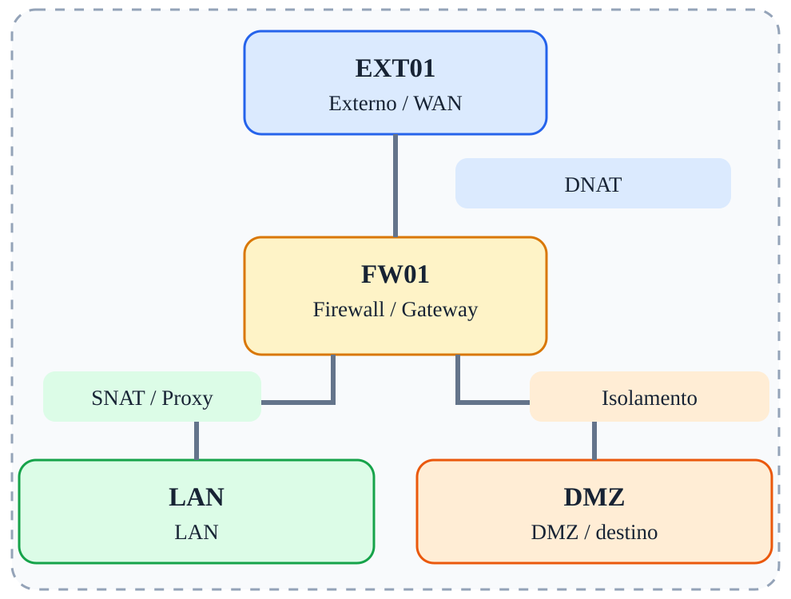

# Fase 10 — Desafio integrador

[← Índice](../README.md)

## Objetivo

Combinar NAT, proxy, firewall stateful e segmentação.

## Ferramentas e verificações

`curl; nc; conntrack; iptables-save; tcpdump`

## Procedimento / exemplo

Requisitos para os alunos:

1. Publicar WEB01 HTTP/HTTPS via DNAT.
2. Bloquear WAN → LAN.
3. Permitir WEB01 → DB01 somente na porta 5432.
4. Permitir HTTP da LAN via Squid e bloquear HTTP direto.
5. Configurar saída autorizada com SNAT ou MASQUERADE.
6. Registrar evidências com tcpdump, conntrack e contadores IPTables.

## Evidências esperadas

- Captura de tráfego mostrando IPs e portas relevantes.
- Saída dos comandos de validação.
- Explicação do caminho do pacote e da decisão de filtragem.

## Cuidados

As regras apresentadas são exemplos isolados, não uma política completa pronta para produção. Execute-as em snapshots descartáveis; preserve acesso administrativo e remova regras de fases anteriores antes de começar uma nova.
